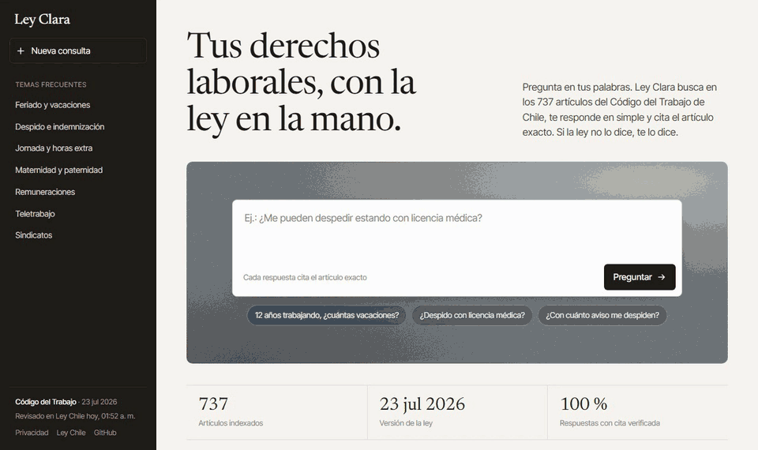

# Ley Clara

**En vivo: [ley.manuel.ac](https://ley.manuel.ac)**

Responde dudas sobre el **Código del Trabajo de Chile** en lenguaje simple, **siempre citando el artículo exacto** con link a Ley Chile. Si ningún artículo respalda la respuesta, lo dice en vez de adivinar.



> **No es asesoría legal.** Explica lo que dice el texto de la ley y puede equivocarse.

Todo corre en Cloudflare: un Worker sirve la API y la página, con D1 (SQLite + FTS5), Vectorize, Workers AI (embeddings `bge-m3`) y un Cron Trigger que revisa Ley Chile cada día. El modelo de lenguaje es Claude Haiku 5.5. Ver el [roadmap](ROADMAP.md).

## Resultados de la evaluación

Set propio de **57 preguntas en lenguaje coloquial** con sus artículos correctos, más **10 preguntas fuera de alcance** (arriendo, tránsito, AFP, herencias…): [eval/preguntas.jsonl](eval/preguntas.jsonl). Código del Trabajo en su versión del 23-jul-2026.

### Respuestas (búsqueda + Claude + validación de citas)

| Métrica | Resultado |
|---|---|
| Citas mostradas que se pueden verificar¹ | **100 %** (169/169) |
| Respuestas que citan un artículo correcto | **96,5 %** (55/57) |
| … cuando la búsqueda trajo el artículo correcto | 98,2 % |
| Abstención correcta (preguntas fuera de alcance) | 90 % (9/10) |
| Abstención indebida (preguntas en alcance) | 1,8 % (1/57) |
| Validación de citas al primer intento | 85,1 % |
| Latencia mediana | 2,6 s |
| Tokens por pregunta (entrada / salida) | ~6.400 / ~480 (≈ US$0,0009 con Haiku 5.5) |

¹ Una cita es válida si (a) el artículo estaba entre los recuperados y (b) el fragmento citado aparece **textualmente** en ese artículo (comparando sin tildes ni mayúsculas). Si una respuesta falla la validación, se reintenta una vez con el detalle del error. Si sigue sin una cita verificable, se reemplaza por "no encontré base legal". Por eso lo que llega al usuario es 100 % verificable; la tasa al primer intento mide cuánto trabajo hace la validación.

La abstención indebida (q15, "renunciar con aviso") ocurre cuando la búsqueda no trae el art. 159: el modelo dice que no tiene base en vez de inventar. El falso positivo fuera de alcance (x07, retiro de fondos AFP) cita el art. 165 sobre la cuenta de indemnización sustitutiva, que es tangencial.

### Búsqueda (antes del LLM)

Medición original sobre 56 preguntas, para elegir el método:

| Modo | hit@1 | **hit@5** | recall@5 | hit@10 | MRR@10 |
|---|---|---|---|---|---|
| FTS5 (BM25 + stemming ligero) | 33,9 % | 55,4 % | 53,6 % | 64,3 % | 0,436 |
| Vectores (bge-m3) | 73,2 % | 96,4 % | 93,8 % | 96,4 % | 0,824 |
| Híbrido RRF, peso FTS 1,0 | 42,9 % | 80,4 % | 77,7 % | 91,1 % | 0,594 |
| Híbrido RRF, peso FTS 0,1 | 60,7 % | 92,9 % | 90,2 % | 96,4 % | 0,748 |
| Híbrido + re-ranking (`bge-reranker-base`) | 41,1 % | 82,1 % | 80,4 % | 96,4 % | 0,590 |

Configuración actual, sobre las 57 preguntas:

| Modo | hit@1 | **hit@5** | recall@5 | hit@10 | MRR@10 |
|---|---|---|---|---|---|
| Vectores | 71,9 % | 94,7 % | 92,1 % | 96,5 % | 0,812 |
| **Vectores + expansión de términos** ← en producción | **73,7 %** | **96,5 %** | **93,9 %** | **98,2 %** | **0,833** |

*hit@k*: % de preguntas con al menos un artículo correcto entre los k primeros. *recall@k*: fracción de los artículos correctos encontrados.

Lo que mostró la medición:
- La búsqueda por palabras falla porque la gente dice "vacaciones" y la ley dice "feriado". Mezclarla con los vectores **empeora** el resultado con cualquier peso probado, y el re-ranker (entrenado sobre todo en inglés) también.
- La **expansión de términos** ([worker/src/sinonimos.ts](worker/src/sinonimos.ts)) agrega a la consulta las palabras que usa la ley ("sueldo" → "remuneración", "me echaron" → "término del contrato"). Corrigió "¿puedo dividir mis vacaciones?" (art. 70) sin empeorar ninguna otra pregunta. Ojo: incluí "dividir/fraccionar" sabiendo que esa pregunta fallaba, así que parte de la mejora puede ser sobreajuste al set.
- La pregunta 57 (jornada vigente) deja el transitorio de la Ley 21.561 en el puesto 7 con búsqueda pura; en `/api/ask` entra igual por su relación con el art. 22 (ver más abajo).

**Límites de esta evaluación**: 57 preguntas es poco y las escribí yo, así que pueden tener sesgo. Por eso la app pide 👍/👎: las preguntas reales mal respondidas van a ampliar el set. "Respalda lo que se afirma" se verifica por fragmento textual por artículo, no por cada frase.

**Valoraciones reales**: `npm run eval:feedback` lee los 👍/👎 de D1 (producción; `-- --local` para la base local), guarda un resumen en `eval/feedback/resumen.json` y deja las preguntas con 👎 que aún no están en el set en `eval/feedback/candidatas.jsonl`, para completar sus artículos correctos y sumarlas a `eval/preguntas.jsonl`. La carpeta está en `.gitignore` porque las preguntas pueden traer datos personales.

Reproducir (con `wrangler dev --var CACHE_HORAS:0` corriendo; si no, la caché devuelve respuestas viejas): `npm run eval:retrieval -- --modos vector` y `npm run eval:answers -- --modelo rapido`. Resultados pregunta por pregunta en [eval/resultados/](eval/resultados/).

## Cómo funciona

```
Ley Chile (XML) ──► ingest/ (Python) ──► seed.sql ──► D1: articulos, chunks, chunks_fts, relaciones
                                                 └──► Workers AI bge-m3 ──► Vectorize

Pregunta ──► Worker /api/ask
              ├─ caché (misma pregunta, mismo día, misma versión de ley y de prompt)
              ├─ protecciones: límite por IP, Turnstile, tope diario
              ├─ búsqueda: vectores sobre la consulta expandida (+ "art. 161" explícito) → top 8
              │            + artículos relacionados (transitorios de leyes graduales)
              ├─ Claude Haiku 5.5: JSON {respuesta, citas[{articulo_id, fragmento}], sin_base_legal}
              ├─ validación: cada cita ∈ recuperados y fragmento textual ∈ artículo
              └─ reintento con feedback, o abstención si no hay cita verificable
```

- **Parser** ([ingest/leyclara/parser.py](ingest/leyclara/parser.py)): los 737 artículos del Código (714 permanentes, 23 transitorios, 4 derogados) con su ruta Libro › Título › Capítulo › Párrafo, su `fechaVersion` y el link directo (`idParte`). Quita las notas al margen de modificaciones ("L. 18.620 / Art. 1° N° 40") que vienen mezcladas en el texto.
- **Chunking**: un chunk por artículo; los largos se dividen por incisos (máx. ~1.500 caracteres), repitiendo número y ruta. 912 chunks (901 del Código y 11 de la Ley 21.561).
- **Stemming en español** para FTS5, idéntico en Python y TypeScript, verificado contra [shared/textnorm_cases.json](shared/textnorm_cases.json).
- **Prompt injection**: los artículos y la pregunta van en etiquetas como datos; las reglas de citado viven en el system prompt y la validación es código, no depende de que el modelo obedezca.

### Leyes con entrada en vigencia gradual

Ley Chile publica el texto consolidado con la redacción final de cada reforma, aunque entre en vigor por etapas. El art. 22 ya dice "cuarenta horas", pero según la Ley 21.561 la jornada fue de 44 horas desde el 26-abr-2024, es de 42 desde el 26-abr-2026 y será de 40 desde el 26-abr-2028. Para no responder algo fiel al texto pero falso hoy:

- Se indexan los **artículos transitorios** de esas leyes ([`NORMAS`](ingest/leyclara/build.py)); por ahora, la Ley 21.561.
- La ingesta detecta qué artículos del Código menciona cada transitorio y guarda la **relación** (el primero transitorio queda vinculado a los arts. 22, 25 bis, 27, 32, 33…). Al recuperar uno de ellos, `/api/ask` agrega el transitorio.
- El modelo recibe la **fecha de hoy** y un **calendario de etapas calculado por código** desde el texto del transitorio ([worker/src/normas.ts](worker/src/normas.ts), con tests contra el texto de la ley), con la etapa vigente marcada. Sin él, Haiku calculaba mal el "quinto año" y respondía 2027.

A "¿cuántas horas semanales es la jornada máxima?" responde "Hoy el máximo es de 42 horas… desde el 26-04-2028 bajará a 40", citando el transitorio y el art. 22.

### Actualización automática

Un **Cron Trigger** ([worker/src/actualizar.ts](worker/src/actualizar.ts)) revisa Ley Chile todos los días a las 10:00 UTC:

1. Consulta la fecha de versión vigente en la API JSON de Ley Chile y la compara con la de D1. Si no cambió (lo normal), termina: unos 8 ms de CPU.
2. Si cambió, descarga el XML y lo parsea con un puerto a TypeScript del parser de Python. Un test de paridad compara ambos sobre los 746 artículos reales: textos, rutas, chunks y relaciones idénticos.
3. Actualiza solo los artículos nuevos, modificados o eliminados en D1, FTS, relaciones y Vectorize.
4. Guarda el resultado (la barra lateral muestra "Revisado en Ley Chile hoy") y, si se configura `ALERTA_WEBHOOK_URL` (Discord, Slack, ntfy…), avisa cuando una norma se actualiza, queda pendiente o falla.

Por qué dos endpoints: el XML está detrás de CloudFront, que responde 429/401 ("Service limit has been reached") a las IP compartidas de Cloudflare cuando el documento no está en su caché; la API JSON sí responde. Si el XML no se puede descargar, la norma queda `pendiente` y se reintenta al día siguiente con la versión anterior en uso. La sincronización compara contra D1, así que es idempotente. Si una actualización grande excede el límite de CPU del plan gratuito, la alternativa es `npm run deploy` en local.

## Privacidad, costos y abuso

- **Privacidad** ([/privacidad](https://ley.manuel.ac/privacidad)): la pregunta se envía a Anthropic para responder y no se guarda, salvo que el usuario marque 👍/👎 (se guarda anónima, sin IP). Las preguntas nunca van en la URL, así que no quedan en los logs de Cloudflare. Las recientes se guardan solo en el navegador. Sin cookies propias ni analítica.
- **Costos**: caché de 24 h por pregunta, límite de 10 preguntas por minuto por IP (binding `ratelimits`; aproximado: en una ráfaga de 60 bloqueó las últimas 6), tope global de `MAX_PREGUNTAS_DIA` preguntas nuevas al día (1.500 ≈ US$1,4) y, recomendado, un límite mensual en la consola de Anthropic.
- **Bots**: [Cloudflare Turnstile](https://developers.cloudflare.com/turnstile/) opcional en `/api/ask`. Se activa al definir `TURNSTILE_SITE_KEY` (var) y `TURNSTILE_SECRET` (secreto); sin ellos, el sitio funciona igual.

## Correr en local

Requisitos: Node 22+, Python 3.11+ con [uv](https://docs.astral.sh/uv/), y `wrangler login` (Vectorize y Workers AI no tienen simulador local).

```bash
npm install
cd ingest && uv run python -m leyclara.fetch && uv run python -m leyclara.build && cd ..   # descarga (cacheada) + seed.sql
npm run db:migrate:local && npm run db:seed:local
cp .dev.vars.example .dev.vars        # ANTHROPIC_API_KEY y ADMIN_TOKEN
npx wrangler vectorize create leyclara-chunks --dimensions 1024 --metric cosine   # una vez
npm run dev
# indexar los vectores que falten (repetir con offset=100, 200, … hasta "siguiente": null)
curl -X POST -H "Authorization: Bearer $ADMIN_TOKEN" "localhost:8787/admin/index?offset=0&limit=100&faltantes=1"
```

Sin cuenta de Cloudflare: `npx wrangler dev --env offline` (solo FTS, sin vectores).

Tests: `cd ingest && uv run pytest` (parser, normas, stemming) y `npx vitest run` (citas, búsqueda, paridad del parser, calendario, alertas).

> En Windows, si `wrangler dev` queda colgado, revisa que no queden procesos `workerd.exe` de corridas anteriores ocupando el puerto 8787.

## API

| Método | Ruta | Descripción |
|---|---|---|
| GET | `/api/meta` | Versión de la ley, normas, última revisión |
| GET | `/api/articulos/:id` | Texto completo de un artículo (`67`, `152-quater-j`, `l21561-t-primero`) |
| POST | `/api/ask` | `{pregunta, turnstile?}` → respuesta, citas validadas, artículos recuperados |
| POST | `/api/search` | `{q, k?, modo?, expandir?}` → artículos (`vector`, `fts`, `hybrid`, `hybrid_rerank`) |
| POST | `/api/feedback` | `{pregunta, util, citas, abstencion}` → guarda la valoración |

## Deploy

Un solo Worker sirve la API y la página (Workers Static Assets).

```bash
npm run deploy        # scripts/deploy.sh
```

El script crea la D1 remota si no existe, aplica las migraciones, carga `seed.sql`, sube `ANTHROPIC_API_KEY` desde `.dev.vars` si falta en Cloudflare, despliega y prueba la API. Para cambiar la key: `powershell -ExecutionPolicy Bypass -File scripts\set-api-key.ps1`. El dominio `ley.manuel.ac` se declara en `routes` de `wrangler.jsonc` como custom domain.

## Fuente y licencia

Texto legal: **Ley Chile – Biblioteca del Congreso Nacional**: [Código del Trabajo](https://www.bcn.cl/leychile/navegar?idNorma=207436) (DFL 1 de 2002) y [Ley 21.561](https://www.bcn.cl/leychile/navegar?idNorma=1191554). Obtenido de Ley Chile; la fecha de la última revisión aparece en la app. Los textos legales oficiales no están protegidos por derecho de autor ([condiciones de Ley Chile](https://www.bcn.cl/leychile/api/condiciones-de-uso)); la BCN no es responsable del contenido de las respuestas.

Código bajo licencia [MIT](LICENSE).
